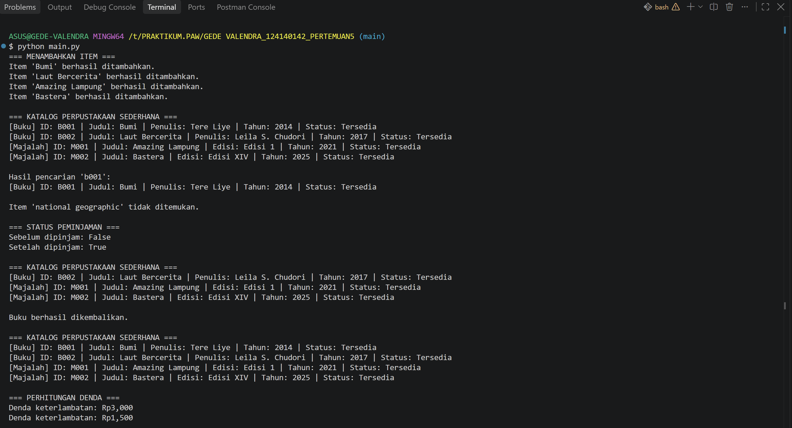

# Sistem Manajemen Perpustakaan Sederhana

## 1. Identitas Mahasiswa

- **Nama Lengkap:** Gede Valendra
- **NIM:** 124140142
- **Kelas Praktikum:** Praktikum PAW (RB)

## 2. Deskripsi Program

Program ini merupakan sistem manajemen perpustakaan sederhana yang dibuat menggunakan bahasa Python dan konsep Object-Oriented Programming (OOP). Program dapat menambahkan buku dan majalah, menampilkan katalog item yang tersedia, mencari item berdasarkan judul atau ID, melihat status peminjaman, serta menghitung denda keterlambatan.

### Penerapan Konsep OOP

1. **Class:** Program memiliki class `LibraryItem`, `Book`, `Magazine`, dan `Library` sebagai cetak biru objek.
2. **Inheritance:** Class `Book` dan `Magazine` mewarisi atribut serta method dari abstract class `LibraryItem`.
3. **Encapsulation:** Data item menggunakan atribut protected seperti `_judul`, sedangkan koleksi pada class `Library` menggunakan atribut private `__koleksi`. Status peminjaman juga disimpan sebagai atribut private.
4. **Polymorphism:** Method `get_detail()` dan `hitung_denda()` memiliki implementasi berbeda pada class `Book` dan `Magazine`.
5. **Property Decorator:** Property `is_dipinjam` digunakan untuk melihat status peminjaman item.


## 4. Panduan Menjalankan Program

Pastikan Python sudah terinstal. Buka terminal pada folder project, kemudian jalankan perintah dibawah ini

```bash
python main.py
```

## 5. Output Program


