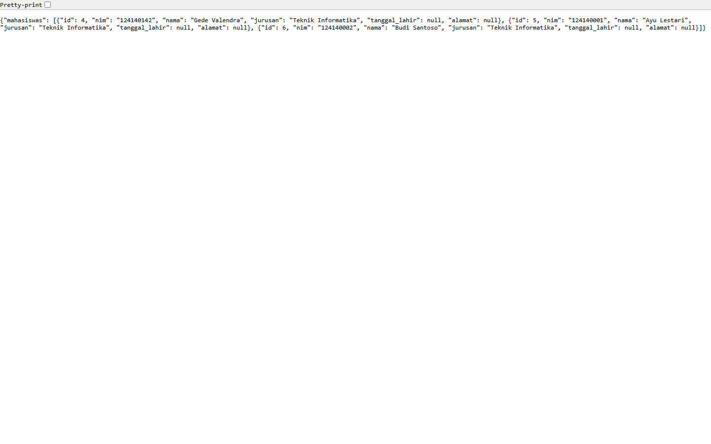
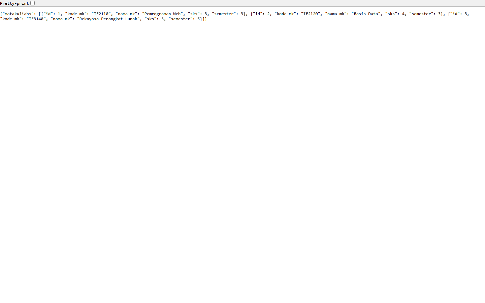
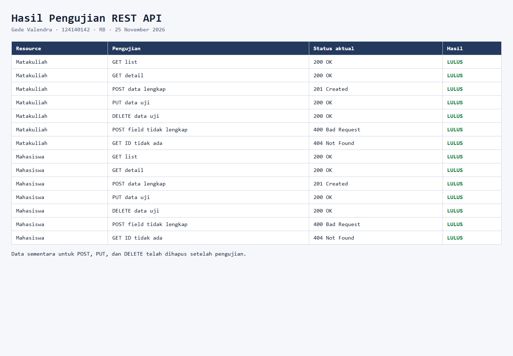

# Pertemuan 6 — Pyramid Framework

## Identitas

- Nama: Gede Valendra
- NIM: 124140142
- Kelas Praktikum: RB

## Deskripsi

Aplikasi RESTful API berbasis Pyramid, SQLAlchemy, Alembic, dan PostgreSQL
untuk mengelola data Mahasiswa (latihan modul) dan Matakuliah (tugas
praktikum). Kedua resource menyediakan operasi Create, Read, Update, dan
Delete dengan respons JSON serta validasi HTTP 400 dan 404.

## Fitur

- CRUD Mahasiswa lengkap.
- CRUD Matakuliah lengkap.
- Validasi field wajib dan bilangan positif untuk `sks` dan `semester`.
- Proteksi duplikasi NIM dan kode matakuliah.
- Migrasi Alembic terpisah untuk tabel `mahasiswa` dan `matakuliah`.
- Seeding 3 mahasiswa dan 3 matakuliah.

## Persiapan PostgreSQL

Masuk ke `psql` atau Query Tool pgAdmin sebagai administrator. Jalankan setiap
perintah secara terpisah:

```sql
CREATE USER pyramid_user WITH ENCRYPTED PASSWORD 'pyramid_pass';
CREATE DATABASE pyramid_mahasiswa OWNER pyramid_user;
```

Jika role sudah tersedia, samakan password-nya:

```sql
ALTER USER pyramid_user WITH PASSWORD 'pyramid_pass';
```

## Instalasi dan Menjalankan Aplikasi

Jalankan perintah berikut dari folder proyek ini:

```powershell
python -m venv venv
venv\Scripts\Activate.ps1
python -m pip install --upgrade pip setuptools
pip install -e .
python -m alembic -c development.ini upgrade head
python -m pyramid_mahasiswa.scripts.initialize_db development.ini
python -m pyramid.scripts.pserve development.ini
```

Perintah `python -m ...` juga dapat digunakan pada Python global jika seluruh
dependency sudah terpasang.

Server tersedia di `http://localhost:6543`.

## Endpoint

| Method | Endpoint | Fungsi |
|---|---|---|
| GET | `/api/mahasiswa` | Daftar mahasiswa |
| GET | `/api/mahasiswa/{id}` | Detail mahasiswa |
| POST | `/api/mahasiswa` | Tambah mahasiswa |
| PUT | `/api/mahasiswa/{id}` | Ubah mahasiswa |
| DELETE | `/api/mahasiswa/{id}` | Hapus mahasiswa |
| GET | `/api/matakuliah` | Daftar matakuliah |
| GET | `/api/matakuliah/{id}` | Detail matakuliah |
| POST | `/api/matakuliah` | Tambah matakuliah |
| PUT | `/api/matakuliah/{id}` | Ubah matakuliah |
| DELETE | `/api/matakuliah/{id}` | Hapus matakuliah |

Contoh payload matakuliah:

```json
{
  "kode_mk": "IF2110",
  "nama_mk": "Pemrograman Web",
  "sks": 3,
  "semester": 3
}
```

## Pengujian Manual

Gunakan cURL atau Postman untuk menguji setiap endpoint. Contoh cURL:

```powershell
curl.exe -X GET http://localhost:6543/api/matakuliah
curl.exe -X POST http://localhost:6543/api/matakuliah `
  -H "Content-Type: application/json" `
  -d '{"kode_mk":"IF2110","nama_mk":"Pemrograman Web","sks":3,"semester":3}'
```

Pengujian end-to-end pada 25 November 2026 mencakup seluruh operasi GET,
POST, PUT, DELETE serta respons 400 dan 404. Data uji sementara telah dihapus
kembali setelah pengujian.

## Dokumentasi Pengujian

### GET Mahasiswa



### GET Matakuliah



### Seluruh CRUD dan Validasi



Laporan lengkap tersedia di
[`docs/api-test-report.html`](docs/api-test-report.html).

## Struktur Penting

```text
pyramid_mahasiswa/
├── alembic/versions/       # Dua revisi migrasi
├── models/                 # Mahasiswa dan Matakuliah
├── scripts/initialize_db.py
├── views/                  # Controller CRUD JSON
└── routes.py               # URL Dispatch + request_method
```

